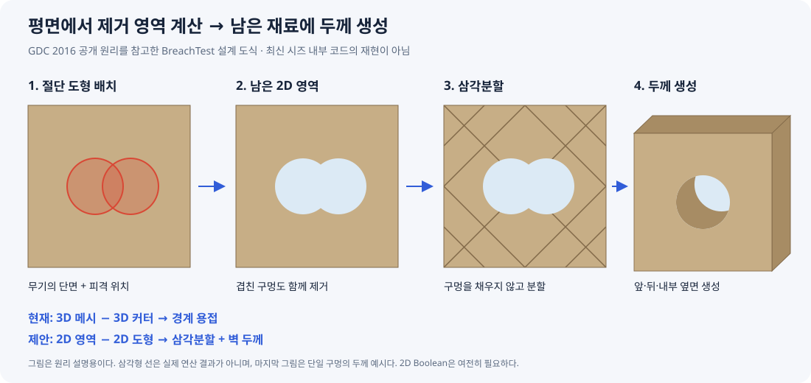

# 시즈 방식 벽 파괴 기획

평평한 벽의 파괴 상태를 **남아 있는 2D 영역**으로 관리하고, 그 영역에 벽 두께를 붙여 3D 메시를 만드는 방식을 검토한다. 목적은 기존 구멍 주변에 반복 피격할 때도 구멍이 자연스럽게 합쳐지게 하는 것이다.

현재 프로젝트는 **3D Mesh Boolean + 관통 길이 자동 계산 + 길이 1 커터 캐시**를 사용한다. 아래 2D 방식은 아직 구현되지 않은 제안이다. 이번 작업은 자료와 기획 저장이며 Unreal 빌드·PIE 검증은 수행하지 않았다.

## 자료 열기

- [인터랙티브 시각화](../시각화/siege-wall-destruction.html): 브라우저로 열고 벽을 클릭한다. 겹친 피격·테두리 피격 예시, 처리 단계, 두께에 따른 옆모습을 확인할 수 있다.
- 아래 그림은 문서 안에서 보는 요약이다.



시각화는 설명용 SVG 마스크로 구멍의 합쳐짐을 표시한다. 실제 폴리곤 Boolean, 삼각분할, Unreal 메시·충돌 생성은 실행하지 않는다. 화면의 크기는 학습용이며 게임의 Radius 1과 같은 축척이 아니다.

## 1. 조사 결과: 어디까지 알려져 있나

### 공개된 개발자 설명

Ubisoft의 Julien L’Heureux가 발표한 GDC 2016 자료에는 평면 표면을 2D로 투영하고, 절단 폴리곤과 연산한 뒤 삼각분할·두께 생성을 거치는 흐름이 나온다. Weiler–Atherton은 예시 알고리즘으로 제시되므로 실제 내부 라이브러리 이름으로 단정하지 않는다. Ear Clipping과 여러 구멍 처리도 설명한다. [발표 PDF, 35–40쪽](https://media.gdcvault.com/gdc2016/Presentations/LHeureux_Julien_Art_Of_Destruction.pdf#page=35)

같은 발표는 재질별 부품·연결 그래프, 단순화된 충돌과 사격용 정밀 충돌, 대체 메시를 이용한 파편, 비동기 처리·시간 분할·복잡도 제한, 메시 대신 이벤트를 전달하는 동기화를 다룬다. 따라서 평면 절단은 전체 파괴 시스템의 일부다. [발표 PDF, 29–33쪽·52–55쪽·61–81쪽](https://media.gdcvault.com/gdc2016/Presentations/LHeureux_Julien_Art_Of_Destruction.pdf#page=29)

이 자료는 **2016년 공개 설명**이다. 최신 시즈의 모든 내부 구현이 같다는 증거, 전체 소스 코드, 정확한 클래스·자료구조는 확보하지 못했다.

### 독립 구현과 연구

- **직접 구현한 커뮤니티 사례:** DWO는 시즈와 비슷한 벽 파괴를 만들며 `Raycast → Clipper → 삼각분할 → 메시/UV/Normal 생성` 과정을 코드와 함께 공유했다. 구멍이 늘어날수록 전체 재삼각분할 비용이 증가했다고 보고한다. 시즈 내부 코드가 아닌 개인 구현이다. [Unity Discussions, 2020](https://discussions.unity.com/t/need-help-with-slow-mesh-triangulation/779061)
- **연구 자료:** Thomas·Zhang의 논문 §2.2와 Fig. 4도 GDC 설명을 정리한다. 자체 실험은 별도 구현이므로 시즈 소스 분석과 구분한다. [Real-time fracturing in video games, 2022 공개 / 2023 권호](https://link.springer.com/article/10.1007/s11042-022-13049-x)

이하의 자료구조·좌표 정책·개발 단계는 **BreachTest에 적용하기 위한 우리 설계안**이다.

## 2. 현재 방식과 제안 방식

| 항목 | 현재 BreachSystem | 제안: 평면 벽 전용 경로 |
| --- | --- | --- |
| 파괴 상태 | 이미 잘린 `FDynamicMesh3` | 남은 2D 영역: 외곽선 + 내부 구멍 + 분리된 영역 |
| 피격 처리 | 벽 메시에서 3D 커터를 Difference | 남은 영역에서 2D 절단 도형을 Difference |
| 반복 피격 | 기존 구멍의 3D 면·경계와 다시 교차 | 기존 구멍과 새 절단 영역을 합친 결과로 윤곽 갱신 |
| 관통 | 월드 AABB의 8개 코너를 정사영해 커터 길이 계산 | 남은 영역을 벽의 앞·뒤 면까지 두께 생성 |
| 커터 캐시 | 단면 크기 유지, 길이 1 메시 캐시 | 벽과 무관한 2D 단면 정점 캐시를 검토 |
| 메시 생성 | `FMeshBoolean` 결과 사용 | 앞·뒤 면 삼각분할 + 윤곽을 잇는 옆면 생성 |
| 적용 대상 | 3D 메시 입력 경로 | 첫 단계는 평평한 직사각형 벽 패널 |

**Boolean을 전부 없애는 것은 아니다.** 평면 벽 경로에서 `FMeshBoolean` 대신 2D 폴리곤 Difference를 쓰는 제안이다. 현재 경로를 곧바로 전체 교체하는 것으로 확정하지 않는다.

현재 소스 확인 위치:

- [BreachableMeshComponent.cpp](../../../Plugins/BreachSystem/Source/BreachSystem/Private/BreachableMeshComponent.cpp): `ApplyBreachHit`, 성공한 결과만 프록시에 적용.
- [BreachSourceComponent.cpp](../../../Plugins/BreachSystem/Source/BreachSystem/Private/BreachSourceComponent.cpp): 길이 1 캐시, `ResolveCutterMesh`의 관통 Transform 계산.
- [BreachSourceComponent.h](../../../Plugins/BreachSystem/Source/BreachSystem/Public/BreachSourceComponent.h): 현재 바인딩 API.

위 링크는 이 문서 위치에서 저장소 루트까지 이동하는 상대 경로다. 이후 코드 변경 시 설명과 실제 소스를 함께 확인한다.

## 3. 현재 문제와 기대 효과

사용자는 기존 구멍 주변에 다시 사격할 때 `UnweldedEdges=100`, `683` 등의 실패가 발생한다고 보고했다. 관통 길이 자동 계산 후 실패가 줄었다는 관찰도 있다.

현재 로그의 수치는 `MeshBoolean.CreatedBoundaryEdges.Num()`이다. UE 5.8.2의 `MeshBoolean.cpp` / `MeshBoolean.h`에서 새 절단 경계의 용접 경로를 확인했다. **구멍 개수나 원본 메시의 모든 경계 개수를 뜻하지 않는다.** 현재 코드에서는 실패한 결과를 벽에 적용하지 않는다.

반복 절단의 짧은 경계·작은 삼각형·교차 상황이 원인일 가능성이 있지만, 해당 런타임 결과 메시를 분석해 정확한 실패 조건을 확정한 것은 아니다. 현재 커터 방향 입력은 `Hit.ImpactNormal`이고 PointDamage 경로에서 반전된다. 구멍 안쪽 면을 맞았을 때 방향이 달라지는지도 별도로 확인할 항목이다.

제안 방식은 이 평면 벽 경로에서 3D 절단 경계 용접에 의존하지 않게 한다. 대신 2D 교차점 정밀도, 윤곽 정리, 구멍을 포함한 삼각분할을 올바르게 처리해야 한다. **2D로 바꾸면 모든 실패와 성능 문제가 사라진다는 보장은 없다.**

## 4. 게임에서 원하는 동작

1. 무기는 게임 데이터를 이용해 단면만 바인딩한다. 예: 총알 `Radius=1`, 해머 `Size=(300,400)`.
2. 벽을 맞으면 피격 위치를 벽의 2D 좌표로 옮기고 해당 단면을 제거한다.
3. 겹친 구멍은 하나의 제거 영역으로 합쳐진다. 겹친 부분이 다시 채워지거나 구멍 사이에 불필요한 면이 생기면 안 된다.
4. 벽 테두리를 넘는 절단은 테두리가 열린 모양으로 처리한다. 모든 절단을 닫힌 내부 구멍으로 저장하지 않는다.
5. 같은 위치·같은 모양을 다시 적용하면 남은 영역이 변하지 않는다. 변화가 없으면 메시·충돌 재생성을 생략한다.
6. 파괴할 벽 재료가 없으면 형상 변화는 없다. 완전히 제거된 경우 빈 결과도 유효한 파괴 상태다.

`Damage=30`이 어느 크기의 구멍을 만드는지는 게임/재질 정책이다. 이번 초기 검증에서는 Damage를 자동으로 Radius에 변환하는 새 규칙을 넣지 않는다.

## 5. 좌표와 두께 정책

### 초기 제안: Cube 기반 평면 패널

초기 대상은 로컬 X가 가로, Z가 세로, Y가 두께인 직사각형 패널이다. 임의 StaticMesh를 자동으로 평면 벽으로 해석하지 않는다. 구부러진 벽·복잡한 입체 장식의 자동 추출은 초기 범위 밖이다.

배치된 패널에서 월드 평면 기준 `Origin`, 서로 수직인 단위 벡터 `U`, `V`, 법선 `N = U × V`와 실제 월드 두께 `T`를 초기화한다. **2D 좌표의 단위도 월드 cm로 유지**한다. 무기의 Radius 1이 벽 Scale에 따라 달라지는 문제를 피하기 위한 설계다.

```text
피격 위치 P를 2D로:
    u = Dot(P - Origin, U)
    v = Dot(P - Origin, V)

2D 정점 q=(u,v)를 앞/뒤 면으로:
    Front = Origin + U*u + V*v + N*(T/2)
    Back  = Origin + U*u + V*v - N*(T/2)

프록시에 저장할 때:
    LocalVertex = ComponentTransform.InverseTransformPosition(WorldVertex)
```

예를 들어 원본 Cube가 한 변 100 cm이고 Scale이 `(5, 0.1, 5)`이면 초기 패널 크기는 `500 × 500 cm`, 두께는 `10 cm`다. 이 값은 원본 메시가 해당 Cube일 때만 성립한다.

`T`는 벽 자체의 두께다. 무기의 Cut Depth와 다르며, 초기화 후 런타임 크기 변경은 초기 범위에 넣지 않는다. 깊이를 매번 정하거나 AABB를 정사영해 커터를 늘릴 필요는 이 경로에서 없어진다.

첫 단계는 **벽 법선 방향으로 같은 단면을 관통**시키는 규칙을 제안한다. 피격면 법선이 바뀌어도 저장된 패널 법선을 유지한다. 비스듬한 탄도의 타원형 단면·앞뒤 위치 차이·옆면 피격 처리는 아직 별도 결정이 필요하다. 이 제안이 실제 사격 방향을 보존하는 절단과 같다고 보지 않는다.

## 6. 저장할 데이터와 피격 처리

아래 이름은 개념 설명이며 확정된 C++ 클래스/API가 아니다.

| 소유자 | 데이터 | 수명 / 용도 |
| --- | --- | --- |
| 무기 / BreachSource | 원·사각형 단면과 크기, 캐시된 2D 정점 | 바인딩 때 생성, 피격 시 위치만 적용 |
| 벽 패널 | 평면 기준, 초기 외곽, 고정 두께 | 패널 초기화 때 생성 |
| 벽 패널 | 현재 남은 영역 목록 | 성공한 절단 때 교체; 영역마다 외곽선·구멍 소유 관계 보관 |
| 벽 프록시 | 렌더 메시, 충돌 | 현재 영역에서 파생되는 결과 |
| 연산 작업 | 후보 윤곽, 삼각형, 생성 메시 | 검증 후 적용하거나 실패 시 폐기 |

단순히 `구멍 목록`만 더하는 방식으로 끝내지 않는다. 서로 겹친 구멍, 벽 밖으로 열린 절단, 남은 벽이 여러 조각으로 분리되는 상황을 표현할 수 있어야 한다.

```text
게임 데이터 → 기존 BindCylinder / BindBox 사용 의도 유지
                           ↓
피격 위치 → 벽 평면의 2D 좌표 → 위치에 맞춘 절단 도형
                           ↓
Candidate = Difference(CurrentRemainingArea, CutPolygon)
                           ↓
영역 변화 없음 → 종료
                           ↓
윤곽 유효성 검사 → 구멍 포함 삼각분할
                           ↓
앞·뒤 면 생성 → 각 외곽/구멍 윤곽에 옆면 연결
                           ↓
메시 유효성 + 충돌 준비 → 영역·렌더·충돌 상태 함께 적용
```

상태 갱신은 성공한 후보만 적용한다. 윤곽만 바뀌고 렌더/충돌은 이전 상태로 남는 부분 적용을 피한다. 비동기화를 도입한다면 이 원칙을 유지할 적용 시점도 설계해야 한다.

원은 유한한 다각형으로 근사하고 분할 수를 바인딩 시 정한다. 첫 검증에서는 기존 단면 품질과 비교 가능한 값을 사용한다. 폴리곤 라이브러리와 삼각분할 라이브러리는 다중 구멍·분리 영역·접점 사례 및 Unreal/C++ 통합·라이선스를 확인한 뒤 선택한다. 시즈가 사용한 것으로 추정해서 선택하지 않는다.

## 7. 충돌·재질·성능

첫 검증에서는 생성 메시와 사격 충돌의 구멍이 일치하는지를 우선 확인한다. 시즈처럼 단순 충돌에서 작은 구멍을 제거하는 정책은 나중에 별도로 정한다. 작은 총알 구멍과 캐릭터가 통과할 구멍을 같은 크기 기준으로 평가하지 않는다.

앞·뒤 면 UV는 고정된 패널 좌표에서 구한다. 매 피격마다 새 Bounds로 UV를 정규화하면 텍스처가 움직일 수 있다. 옆면은 윤곽의 누적 길이와 두께를 사용하고, 단면 재질은 별도로 검토한다. 앞·뒤·내부 면의 Normal과 winding을 검사한다.

캐시는 **2D 단면 생성 비용**을 줄인다. 잘린 벽 결과는 피격 이력에 따라 달라지므로 단면 캐시만으로 클리핑·삼각분할·충돌 비용이 사라지지 않는다.

먼저 같은 벽에 누적 `1 / 10 / 50 / 100`회 피격시키고 다음을 측정한다.

- 클리핑, 삼각분할, 메시 생성, 렌더 적용, 충돌 갱신 각각의 시간.
- 전체 피격 처리의 중앙값·95백분위·최댓값, 프레임 지연.
- 정점·삼각형·윤곽 개수와 메모리 증가.
- 실패 수와 유효하지 않은 결과가 적용된 횟수.

현재 3D 경로와 동일한 단면·피격 위치·벽 Transform으로 비교한다. GDC 수치를 우리 성능 목표로 그대로 가져오지 않는다. 전체 재삼각분할이 병목으로 확인되면 영향 구역 제한, 벽 분할, 비동기 처리 순으로 필요성을 검토한다.

## 8. 개발 단계와 완료 기준

아래는 다음 구현을 위한 계획이며 이번 문서 작업에서 실행한 테스트가 아니다.

| 단계 | 최소 작업 | 검증 / 완료 기준 |
| --- | --- | --- |
| 1. 2D 연산 검증 | 원·사각형 Difference, 영역/구멍 구조 | 겹침·테두리·분리 영역의 예상 윤곽과 일치 |
| 2. 패널 메시 | 앞뒤 삼각분할, 옆면, Normal·UV | 관통 구멍에 뚜껑이 없고 닫힌 재료 경계에 비정상 열린 에지 없음 |
| 3. 게임 연결 | 현재 바인딩 의도 유지, 평면 패널에 적용 | 같은 게임 데이터로 크기 유지; 기존 소스/타깃 책임 분리 유지 |
| 4. 충돌·비교 | 사격/이동 충돌 확인, 누적 피격 계측 | 아래 기능 사례 통과, 비용과 한계 기록 |

기능 검증 목록:

- [ ] 최초 피격: 앞뒤가 뚫리고 구멍 내부 옆면이 존재한다.
- [ ] 같은 위치 반복: 영역과 메시가 불필요하게 증가하지 않는다.
- [ ] 겹침: 작은 이동 간격으로 100회 피격해 구멍이 합쳐진다.
- [ ] 접점/미세 간격: 거의 닿는 도형에서 윤곽·삼각분할의 정밀도 정책을 확인한다.
- [ ] 테두리/모서리: 외부까지 연결된 절단이 제대로 열린다.
- [ ] 분리: 절단으로 남은 벽이 둘 이상이 되어도 모든 영역이 생성된다.
- [ ] 전체 제거: 빈 영역을 성공으로 처리하고 렌더·충돌을 제거한다.
- [ ] 회전·비균일 Scale: `(5,0.1,5)`에서도 월드 Radius 1과 Box 300×400이 유지된다.
- [ ] 앞면/뒷면 피격: 같은 패널 좌표의 단면이 일치한다.
- [ ] 충돌: 구멍을 통과하는 사격과 남은 면을 맞는 사격을 구별한다. 충분히 큰 구멍에서는 이동도 통과한다.
- [ ] 실패 처리: 의도적으로 실패시킨 후보가 현재 영역·메시·충돌에 부분 적용되지 않는다.
- [ ] 성능: 누적 피격별 비용과 실패 수를 기존 3D 경로와 비교해 기록한다.

초기 검증 이후 항목은 다층 재질, 장식, 분리 조각의 물리적 탈락, 파편 풀, 네트워크 동기화다. 이 항목들은 현재 구현 범위로 확정하지 않았다.

## 9. 다음 구현 전 결정할 사항

1. 첫 실험을 별도 평면 패널로 만들지, 기존 BreachableMesh에 제한된 경로로 넣을지.
2. 법선 방향의 일정 단면 관통 규칙으로 시작할지, 실제 탄도에 따른 앞뒤 위치 차이까지 넣을지.
3. 폴리곤 라이브러리·삼각분할 방법·좌표 정밀도와 최소 경계 정책.

우선 제안은 **별도 작은 평면 패널 실험에서 1·2단계를 검증하고, 결과를 보고 기존 컴포넌트 연결 범위를 정하는 것**이다. 문서 저장을 런타임 구조 변경 승인으로 해석하지 않는다.

## 10. 이번 자료의 확인 내역

2026-09-27 기준으로 문서의 로컬 파일 링크, HTML JavaScript 구문, SVG XML을 확인했다. 브라우저에서 원/사각형 입력, 겹침, 같은 위치 반복 시 단면 유지, 테두리 절단, 두께 조작, 단계 설명 전환을 확인했다. 기본 화면과 360 px 폭에서 배치도 확인했다.

이는 **설명 자료의 동작 확인**이다. 실제 폴리곤 연산·Unreal 메시 생성·충돌·성능에 대한 검증 결과는 아니다.
