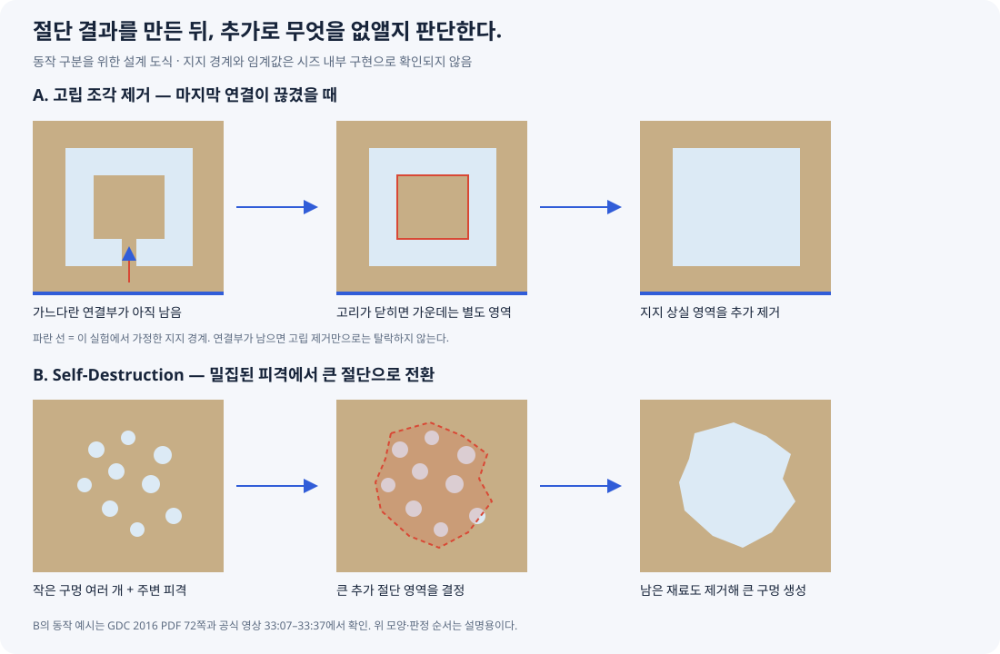

# 시즈의 고립 조각과 누적 파괴 조사

## 조사 질문과 결론

질문은 두 가지다.

1. 구멍을 고리처럼 만들면 왜 가운데 남은 벽 조각도 사라지는가?
2. 주변을 여러 번 쏘면 왜 작은 구멍이 계속 쌓이지 않고 큰 덩어리가 한 번에 부서지는가?

**단면 Difference만으로는 두 동작을 모두 설명할 수 없다.** 2D Difference는 고리 안에 남은 재료도 유효한 영역으로 반환할 수 있다. 따라서 형상 절단 다음에 연결 상태와 추가 파괴 정책을 판단하는 단계가 필요하다.

공식 발표에는 연결 그래프와 `Self-Destruction`이 나온다. 특히 작은 구멍이 많은 벽을 큰 구멍으로 전환하는 예시는 공식 그림과 원영상 설명에서 직접 확인했다. 다만 고립 조각의 정확한 지지 판정, 누적 데미지의 공간 자료구조, 발동 수식과 임계값은 공개 자료에서 확인하지 못했다.



위 그림은 우리 설계의 동작 구분을 위한 도식이다. 시즈의 내부 판정 알고리즘이나 실제 테스트 결과가 아니다.

## 1. 직접 확인한 공식 근거

| 자료 | 확인한 내용 | 여기서 단정할 수 없는 것 |
| --- | --- | --- |
| GDC 2016 PDF 31–33쪽 | 조각은 연결 그래프로 관리하고 절차적 파괴가 새 자식 조각과 연결을 만들 수 있다. | 벽의 모든 지지점·보강재·고립 조각 제거 조건 |
| GDC 2016 PDF 71–72쪽 | 복잡도 제한 항목 다음의 `Self-Destruction` 그림은 다수의 작은 총알 구멍을 하나의 큰 구멍으로 바꾼다. | 특정 면적·구멍 수·연결 폭에서 반드시 발동한다는 수식 |
| 공식 발표 영상 33:07–33:37 | 가까운 곳에 여러 발을 쏠 때 큰 구멍을 만드는 이유로 외관, 게임플레이 선호, 성능을 설명한다. | 전체 벽의 구멍 개수에 고정 상한이 있다는 주장 |
| 공식 발표 영상 41:00–41:54 | 작은 구멍과 큰 파괴에 사용할 표면 데미지를 나누어 다룬다고 설명한다. | 데미지를 저장하는 셀 크기, 감쇠, 임계값, 정확한 알고리즘 |

출처:

- [PDF: 연결 모델, 31쪽부터](https://media.gdcvault.com/gdc2016/Presentations/LHeureux_Julien_Art_Of_Destruction.pdf#page=31)
- [PDF: Self-Destruction, 72쪽](https://media.gdcvault.com/gdc2016/Presentations/LHeureux_Julien_Art_Of_Destruction.pdf#page=72)
- [공식 GDC 채널 영상: 복잡도와 Self-Destruction, 33:07](https://www.youtube.com/watch?v=SjkQxowsL0I&t=1987s)
- [같은 영상: 작은 구멍과 표면 데미지 구분, 41:00](https://www.youtube.com/watch?v=SjkQxowsL0I&t=2460s)
- [GDC 세션 정보: 발표자 Julien L’Heureux / Ubisoft / GDC 2016](https://gdcvault.com/play/1023307/The-Art-of-Destruction-in)

PDF 관련 페이지는 직접 렌더해 확인했다. 영상 설명은 원영상에서 내보낸 영어 자동 자막으로 확인했으며 고유명사·알고리즘 이름은 슬라이드와 대조했다. 자동 자막의 `cell structure` 같은 표기를 근거로 **시즈가 격자 셀을 사용한다고 주장하지 않는다.**

## 2. 사진의 가운데 영역: 연결이 끊긴 남은 재료

사용자 사진의 파란색은 제거 영역, 가운데 갈색은 남은 벽 재료다. 제거 영역이 가운데를 완전히 둘러싸면 남은 재료는 두 영역으로 분리된다.

```text
남은 영역 A: 벽 가장자리 / 지지 구조와 이어진 바깥 부분
남은 영역 B: 구멍 고리 안에 갇힌 가운데 조각
```

Difference와 삼각분할만 하면 B도 정상적인 재료 영역이므로 그대로 메시가 만들어질 수 있다. 라이브러리 오류가 아니라, 별도의 탈락 규칙이 아직 없는 결과다.

우리 단일 패널 실험에는 다음 규칙을 제안한다.

```text
절단 후 남은 각 연결 영역을 확인
    → 지정한 지지 경계와 연결되어 있으면 유지
    → 지지와 완전히 끊겼으면 벽 렌더·충돌에서 제거
```

초기 실험에서 패널 바깥 경계를 지지 경계로 쓰는 것은 **우리의 단순화**다. 시즈가 모든 벽에 이 규칙을 그대로 적용한다는 근거는 없다. 다층 벽이나 내부 목재 기둥이 있으면 표면의 가운데 조각이 고립돼 보여도 다른 구조가 지지할 수 있다.

크기가 가장 큰 영역 하나만 남기는 규칙도 피한다. 가운데를 세로로 잘라도 양쪽 벽이 각각 지지될 수 있기 때문이다. 어떤 영역을 유지할지는 크기만으로 결정하지 않는다.

이 단계에서 할 일은 **고립된 재료를 제거**하는 것이다. 작은 총알 구멍을 메우는 일이나 구멍끼리의 Union과는 다른 처리다.

## 3. 같은 곳 주변 여러 발: Self-Destruction과 누적 파괴

근처에 생긴 구멍들이 겹치면 Difference만으로도 큰 구멍처럼 보일 수 있다. 하지만 공식 `Self-Destruction` 예시는 작은 구멍이 많은 영역을 더 큰 파괴 영역으로 전환한다. 이는 현재 형상보다 더 많은 재료를 없애는 동작이다.

우리 구현에서는 다음 두 상태를 구분하는 것이 필요하다.

| 상태 | 역할 |
| --- | --- |
| 형상 상태 | 어디가 이미 비어 있고 어디에 재료가 남아 있는가? |
| 국소 파괴 상태 | 실제 재료가 피격된 주변에 파괴 영향이 얼마나 누적됐는가? |

가능한 최소 설계는 **유효한 피격을 주변 범위에 누적하고, 기준을 넘으면 작은 총알 단면 대신 더 큰 절단 패턴을 추가 적용**하는 것이다. 공간 집계 방법·범위·임계값·큰 패턴은 프로토타입에서 결정할 항목이다. 시즈에서 역추출한 수치가 아니다.

```text
재료 피격
    ├─ 작은 절단 / 피격 표현
    └─ 주변 파괴 영향 누적
            ↓
       큰 파괴 조건 충족?
            ↓ 예
       더 큰 절단 패턴 적용
            ↓
       연결 상태 다시 판정 → 고립 조각 제거
```

완전히 빈 구멍을 통과한 탄환을 같은 벽의 새 피격으로 무조건 집계하지 않는다. 남은 재료를 실제로 맞았는지 먼저 구분한다. 뒤쪽 재질층을 맞았다면 그 층에는 별도 파괴 영향이 생길 수 있다.

가느다란 연결부가 아직 남은 상황도 고립과 구분한다. 연결은 존재하므로 고립 판정만으로는 탈락하지 않는다. 이를 부수고 싶다면 연결부의 약화나 국소 파괴 규칙이 추가로 필요하다. 최소 연결 폭 / 손상 비율로 정리하는 방법도 가능하지만, 공개된 시즈의 확정 규칙으로 적지 않는다.

## 4. 무기와 버전에 따라 규칙이 달라진다는 공식 사례

2016년 Red Crow 공식 소개는 무기마다 impact zone과 fragility sphere를 다르게 하고 강한 구경은 더 큰 구멍과 impulse를 만든다고 설명한다. 따라서 무기 입력을 총알 반지름 하나로만 생각하지 않고, 직접 절단과 주변 파괴 영향을 구분할 근거가 있다. [Ubisoft: Season 4 Preview Site Kick-off](https://www.ubisoft.com/en-au/game/rainbow-six/siege/news-updates/3na9VoRVJksPHF6OpPqXPO/season-4-preview-site-kickoff)

2021년 Y6S2.2 패치는 DP-27이 거리에 따라 매 발 구멍을 만들거나, 8 m를 넘으면 세 발 후 구멍을 만드는 변경을 명시했다. 특정 무기·당시 버전의 예시이며, 모든 총이 같은 횟수로 큰 구멍을 만드는 규칙은 아니다. [Ubisoft: Y6S2.2 Patch Notes](https://www.ubisoft.com/en-ca/game/rainbow-six/siege/news-updates/5ZMF9L4RORllBhrRV618tr/y6s22-patch-notes)

또한 Y6S2 공식 노트는 얇은 일부 재질의 예외를 제외하고, 연질 표면의 개별 총알 구멍을 통한 시야를 막고 여러 번 사격해야 볼 수 있는 구멍을 만들도록 바꿨다고 설명한다. 관통 탄환과 시야 확보는 같은 판정으로 가정하지 않는다. [Ubisoft: Y6S2 Pre-Season Designer’s Notes](https://www.ubisoft.com/en-us/game/rainbow-six/siege/news-updates/76KxHcLFOo2PdhSS4t1HmZ/y6s2-preseason-designers-notes)

이 사례들은 정책이 변해 왔음을 보여준다. 현재 시즈의 내부 수치·모든 무기의 규칙이 이 자료와 동일하다고 확인한 것은 아니다.

## 5. 기존 기획에서 보완해야 할 부분

[시즈 방식 벽 파괴 기획](시즈%20방식%20벽%20파괴%20기획.md)의 2D 절단 흐름 사이에 다음을 추가하는 설계 검토가 필요하다.

```text
피격 → 직접 절단 + 유효한 표면 파괴 영향
                  ↓
      누적 파괴 조건 / 추가 절단 패턴
                  ↓
           남은 연결 영역 계산
                  ↓
          지지 상실 영역 제거
                  ↓
     삼각분할 → 두께 → 렌더·충돌 적용
```

기존 문서의 `같은 위치·같은 모양을 다시 적용하면 변화 없음`은 **형상 Difference만의 성질**이다. 누적 파괴를 도입하면 형상 변화가 없더라도 실제 재료가 맞은 유효 이벤트는 국소 파괴 상태를 바꿀 수 있다. 따라서 `형상이 안 바뀜 → 전체 피격 처리 종료`로 구현하면 안 된다. 형상 재생성 생략과 파괴 영향 집계를 따로 판단한다.

바인딩 API의 단면 크기와 게임 Damage를 어떻게 주변 파괴 영향에 연결할지는 아직 미정이다. 플레이어에게 주는 Damage를 벽의 파괴 수치로 자동 재사용하지 않고 별도 의미를 정한다.

우선 검증 순서는 **고립 영역 제거 → 국소 누적 파괴 → 필요할 때 약한 연결부 정리**를 제안한다. 첫 번째만 넣어도 사용자 사진의 가운데 조각 문제를 단일 패널 조건에서 다룰 수 있다. 두 번째가 있어야 구멍이 완전히 연결되기 전에도 큰 덩어리 파괴를 만들 수 있다.

## 6. 추가 검증 사례

- [ ] 닫힌 고리: 마지막 연결이 끊긴 순간 가운데 재료가 렌더·충돌에서 함께 제거된다.
- [ ] 열린 고리: 연결부가 남아 있으면 고립 판정만으로는 가운데를 제거하지 않는다.
- [ ] 두 개의 지지된 영역: 가장 큰 영역만 남기는 잘못된 삭제가 없다.
- [ ] 피격 밀집 / 분산: 같은 총 발수라도 공간적으로 분산된 입력을 무조건 같은 국소 파괴로 취급하지 않는다.
- [ ] 형상 변화 없음 / 유효 재료 피격: 메시 재생성 생략과 국소 파괴 집계를 구별한다.
- [ ] 빈 공간 통과: 타깃 재료를 맞지 않은 탄환을 해당 층의 피격으로 집계하지 않는다.
- [ ] 추가 파괴 후 상태: 렌더·충돌·부착물 상태가 함께 갱신된다.
- [ ] 누적 100회 이후: 큰 파괴 정책 전후의 윤곽·삼각형 수와 처리 비용을 측정한다.

다층 지지·보강재·실제 물리 탈락·네트워크는 후속 범위다. 고립된 조각의 충돌 제거와 날아가는 시각 파편 생성은 별개 작업으로 평가한다.

## 조사 범위와 남은 불확실성

공식 PDF와 GDC 원영상 자막, Ubisoft의 2016·2021년 게시물을 확인했다. 커뮤니티의 micro-destruction / 지역 HP 해석은 조사 단서로만 사용했고 시즈 내부 코드의 증거로 채택하지 않았다.

아직 확인하지 못한 것은 국소 파괴 누적 자료구조, 고립 조각의 실제 지지 규칙, Self-Destruction 패턴 선택, 구멍 수·면적·최소 연결 폭의 수치, 최신 버전 구현이다. 게임 코드 변경·빌드·PIE 검증은 이번 조사에서 수행하지 않았다.
